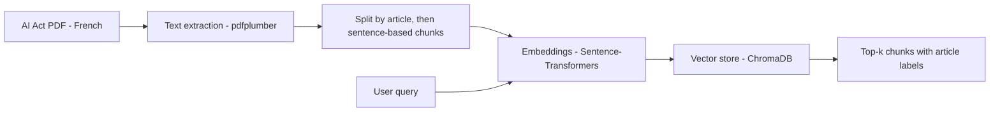

# AI Act Semantic Search

Semantic search over the **European AI Act** (Regulation (EU) 2024/1689): given a question, the system returns the most relevant passages of the regulation, each labelled with its article number.
It does **not** generate answers: it is the retrieval step of a potential RAG pipeline, evaluated on its own.

**Language:** the indexed document is the **French** version of the AI Act, and the evaluation questions are written **in French**.

Everything lives in one notebook: [`AI Act Assistant.ipynb`](AI%20Act%20Assistant.ipynb).

---

## Pipeline



1. **Extraction**: text is extracted page by page with `pdfplumber` (144 pages); runs of spaces and tabs are collapsed.
2. **Chunking**: the text is split into articles with a regex on lines of the form `Article <number>` (112 articles found), then each article is split on sentence boundaries into chunks of about 600 characters (704 chunks). Chunks do not overlap. Each chunk keeps its article label.
3. **Indexing**: each embedding model gets its own ChromaDB collection.
4. **Retrieval**: the query is embedded with the same model and the top-k nearest chunks are returned.

## Models compared

| Model | Hugging Face id | Notes |
|---|---|---|
| MiniLM | `sentence-transformers/all-MiniLM-L6-v2` | Small, trained for English |
| MPNet | `sentence-transformers/paraphrase-multilingual-mpnet-base-v2` | Larger, multilingual |

## Evaluation

- **Dataset**: 37 French questions written by hand, each labelled with the expected article number(s) (Q4 to Q40 in the notebook; 36 questions have one expected article, one has two).
- **Hit@k**: share of questions for which at least one expected article appears in the top-k chunks.
- **MRR@k**: mean over all questions of 1 / rank of the first correct chunk in the top k (0 if none). It is averaged over all 37 questions, misses included.

## Results

Produced by running the notebook top to bottom (fresh kernel, versions in `requirements.txt`):

| Model | Hit@1 | Hit@3 | Hit@5 | MRR@3 | MRR@5 |
|---|---:|---:|---:|---:|---:|
| MiniLM (`all-MiniLM-L6-v2`) | 29.7% (11/37) | 40.5% (15/37) | 48.6% (18/37) | 0.342 | 0.363 |
| MPNet (`paraphrase-multilingual-mpnet-base-v2`) | 51.4% (19/37) | 73.0% (27/37) | 75.7% (28/37) | 0.604 | 0.610 |

MRR@1 is identical to Hit@1 by definition, so it is not reported separately.

On this French corpus, MPNet finds the expected article much more often than MiniLM (75.7% vs 48.6% at k=5), which is expected since MiniLM is an English model. When the article is found in the top 5, both models tend to rank it high (MRR@5 / Hit@5 ≈ 0.81 for MPNet, ≈ 0.75 for MiniLM). For MPNet, most of the gain is reached at k=3.

With only 37 questions, one question is worth 2.7 points: differences of a few points are not meaningful.

---

## How to run

Tested with Python 3.12 on Windows (CPU).

1. **Clone the repository and install the dependencies**

   ```bash
   git clone https://github.com/faraaawo-debug/ai-act-semantic-search.git
   cd ai-act-semantic-search
   python -m venv .venv
   # Windows: .venv\Scripts\activate    macOS/Linux: source .venv/bin/activate
   pip install -r requirements.txt jupyter
   ```

2. **Download the AI Act PDF** (it is not included in the repository)

   Download the official French PDF from EUR-Lex:
   https://eur-lex.europa.eu/legal-content/FR/TXT/PDF/?uri=OJ:L_202401689
   (document page: https://eur-lex.europa.eu/eli/reg/2024/1689/oj)

   Save it as `OJ_L_202401689_FR_TXT.pdf` in the repository root, next to the notebook.

3. **Run the notebook**

   ```bash
   jupyter notebook "AI Act Assistant.ipynb"
   ```

   Then run all cells in order. The first run downloads both models from Hugging Face (roughly 1 GB in total, mostly MPNet). The notebook creates a local `chroma_store/` folder (ignored by git).

No API key is needed: all models run locally.

---

## Limitations

The evaluation pipeline is sound and the numbers reproduce, but the preprocessing has known gaps, measured on the current code. They are listed here rather than hidden, and the main ones are the next steps below.

**Document parsing**
- The article regex misses "Article premier", so the recitals and Article 1 are not indexed (43% of the characters).
- The annexes are attached to Article 113.
- PDF headers and footers remain in 105 of the 704 chunks.

**Chunking**
- Chunks are split only after a period, so 89 exceed the 600-character target (up to 19,189).
- Text beyond the model's input limit is not embedded: MPNet (128 tokens) truncates 257 chunks, MiniLM (256 tokens) 49.
- Chunks do not overlap, and a few identical passages produce ties whose order can vary between runs.

**Similarity**
- ChromaDB uses L2 distance by default, and MPNet embeddings are not normalized in the benchmark, so its ranking is not a true cosine similarity (MiniLM normalizes its own outputs).

**Evaluation**
- 37 questions written and labelled by one person, mostly with a single expected article.
- MiniLM is an English model evaluated on French text, so the comparison mainly shows the value of a multilingual model.

## Next steps

- Normalize embeddings in the benchmark (or set ChromaDB to cosine distance) so the reported scores are true cosine similarity, then re-run the evaluation.
- Recognise "Article premier" and separate the annexes from Article 113, then re-run the evaluation.
- Improve chunking: enforce the size limit, add overlap, remove page headers and footers.
- Extend the evaluation set (more questions, several expected articles per question).
- Optionally, connect the retrieval step to a language model for answer generation (RAG).

## Tech stack

Python, pdfplumber, Sentence-Transformers, ChromaDB, pandas, matplotlib/seaborn.

## License

Code: MIT (see [LICENSE](LICENSE)). The AI Act text is not included; it is available from EUR-Lex (© European Union), whose content may be reused with acknowledgement of the source.
